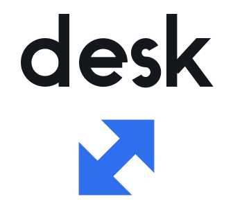
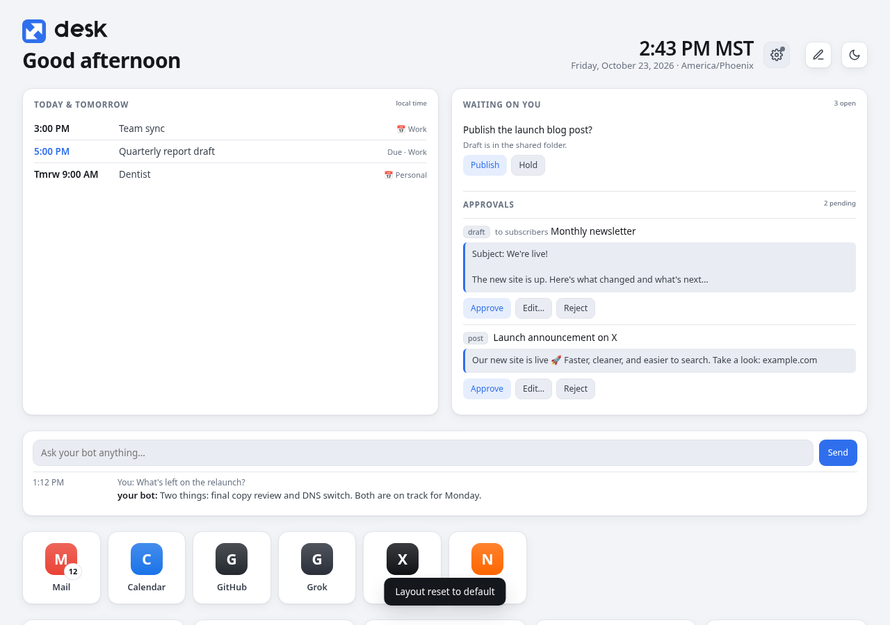
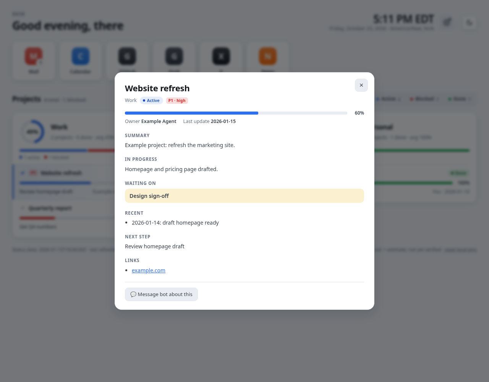
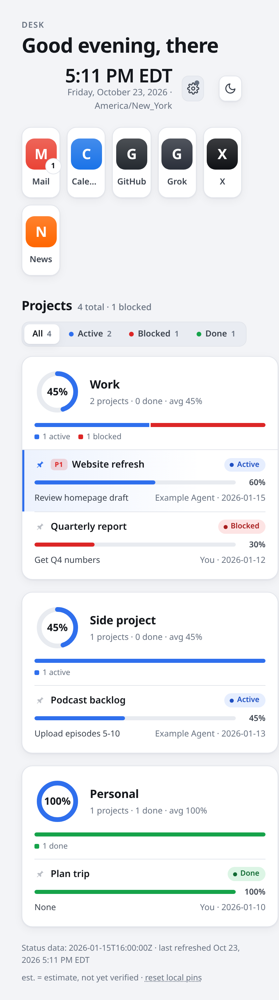

<p align="center"></p>

# Desk

Desk is a single-file, self-contained personal dashboard that you open locally in your browser (`file://`). It shows quick-launch tiles, your projects grouped by area with status, progress, priority and details, and a **Message bot** box that sends a note straight to your Grok Bot through a webhook routine.

> **Desk is deliberately _not_ a kanban or Trello board.** It is organized **by project first, then by progress**, and that is the key difference. Each project is one card with its own status, percent complete and next step. Tasks don't move between "To do / Doing / Done" columns. You see every project at a glance, grouped by area, and each one shows how far along it is and what happens next.

## Screenshots

<p></p>
<p> </p>

_All data shown is fake example data._

## One-line install

```bash
curl -fsSL https://raw.githubusercontent.com/TeebooTed/desk/main/install.sh | bash
```

Works on macOS and Linux (needs `python3` and `curl`). It sets up `~/Desk`, the local relay and its autostart. **This repo is private right now, so the one-liner only works once it is public**; until then clone it and run `./install.sh`.

## Set up Desk with your bot

Paste this to your Grok Bot:

> Set up Desk for me. Follow docs/bot-template.md in github.com/TeebooTed/desk: install it on my computer, create a twice-daily "Desk refresh" routine that writes ~/Desk/status.json and ~/Desk/live.json and rebuilds, and create a "Desk messages" webhook routine that handles [Desk setup], [Desk ask], [Desk routine], [Desk approval] and [Desk · Waiting on you] messages. Then give me the webhook URL and key to paste into Desk's settings. Never put the key in any file other than the relay config.

## Customize the layout

Click the pencil (or press **E**) to drag sections around, resize them, hide them, change the accent, density, font size and corners, and set per-section options. Changes save to `~/Desk/layout.json` through the local relay (and in the browser if the relay is off). Undo/redo, reset, export and import are in the edit bar. Bots can edit the same file; see [docs/layout.md](docs/layout.md). To share layout, pins and widget data between computers, see [docs/sync.md](docs/sync.md).

## Widgets

Add your own cards (links, counters, lists, metrics) via `live.json` `widgets` or a `tiles/` folder. See [docs/widgets.md](docs/widgets.md).

## Files

| Path | Purpose |
|---|---|
| `template.html` | Desk page template (favicon inlined in `<head>`) |
| `build.py` | Fills the template with a status JSON and writes `index.html` |
| `example-status.json` | Fake sample data showing the expected format |
| `relay/desk-relay.py` | Local relay (Python stdlib only) on `127.0.0.1:8765` |
| `install.sh`, `uninstall.sh` | One-step setup and removal |
| `docs/` | Screenshots, [data format](docs/data-format.md), [routine prompts](docs/routines.md) |
| `deploy/` | Example macOS LaunchAgent and Linux systemd user unit |
| `assets/` | Logo, icons, `favicon.svg/.ico`, `apple-touch-icon.png`, `build_logo.py` |

## Quick install (Mac and Linux)

```sh
git clone <this repo> desk && cd desk
./install.sh            # installs to ~/Desk (or ./install.sh /path/to/folder)
./uninstall.sh          # removes the relay service (add --purge to delete files and saved settings)
```

`install.sh` checks for python3, copies Desk, installs and starts the relay service with real paths, builds `index.html` (from `status.json` if present, else the example), opens Desk and prints next steps. It never touches the webhook key. The manual steps below do the same by hand.

## Build

```sh
python3 build.py                 # uses example-status.json
python3 build.py my-status.json  # your own data
open index.html                  # or xdg-open on Linux
```

The status file format is documented in [docs/data-format.md](docs/data-format.md). Edit the `TILES` array in `template.html` to change the launch tiles, and set `area_order` / `area_labels` in status.json to add, rename or reorder project areas (any number of columns).

## Security design

- The webhook URL and key are kept **only** by the local relay, in `~/.config/desk-relay/config.json` (directory `0700`, file `0600`). The browser never sees or stores the key; after saving, the key field is cleared.
- The relay listens on `127.0.0.1` only, never logs requests, and caps request bodies at 100 KB.
- It accepts only requests with **`Origin: null`** (what a `file://` page sends) or no Origin at all. Any website trying to reach it gets HTTP 403.
- Endpoints: `GET /health`, `POST /config` (`{url, auth}`, https only), `POST /send` (`{message, ...}` forwarded to the webhook).
- Never commit `config.json` or your real status file (both are in `.gitignore`).

## Setup on macOS

```sh
git clone <this repo> ~/desk
cp ~/desk/deploy/com.example.desk-relay.plist ~/Library/LaunchAgents/
# edit the path YOUR_USER inside the plist, then:
launchctl load ~/Library/LaunchAgents/com.example.desk-relay.plist
curl -s http://127.0.0.1:8765/health
```

## Setup on Linux

```sh
git clone <this repo> ~/desk
mkdir -p ~/.config/systemd/user
cp ~/desk/deploy/desk-relay.service ~/.config/systemd/user/
systemctl --user daemon-reload
systemctl --user enable --now desk-relay
curl -s http://127.0.0.1:8765/health
```

## Creating a Grok Bot webhook routine

1. In Grok Bot, ask your bot to create a **routine with a webhook trigger** (for example: "Create a webhook routine that treats incoming Desk messages as notes from me").
2. Copy the webhook **URL** and its **authorization key** that the routine shows you.
3. Open `index.html`, click the gear icon (**Connect to your bot**), paste the URL and key, and click **Save**. Desk hands them to the relay and forgets the key.
4. Click **Send test**. The reply arrives in your Grok Bot chat.

Ready-to-paste routine prompts (webhook receiver and twice-daily refresh) are in [docs/routines.md](docs/routines.md).

## Logo

The logo and favicons in `assets/` (light, dark and tile variants) are regenerated with `assets/build_logo.py`.

## License

MIT. See `LICENSE`.

## New: first-run setup, Ask box, routine panel

- **First-run setup**: with no data, Desk shows a Welcome card that asks your bot to fill everything in (or copy the request into chat). See `docs/data-format.md` → *Sample prompt*.
- **Ask your bot**: a one-line box that sends `[Desk ask] …` through the local helper; short replies appear under it after the bot updates `live.json` → `replies`.
- **Routines**: a collapsible panel listing your bot's routines (schedule, next/last run, status) with Pause / Resume / Run now. Failures are highlighted.

All page-to-bot messages go through the local helper on 127.0.0.1:8765; no webhook secret is ever in the page or data files.
- **Teammates**: one compact card per agent (what it is doing, what it waits on).
- **Activity today**: what your bot actually did (sends, deploys, edits, posts), newest first.
- **Approvals**: drafts and posts in "Waiting on you" with Approve / Edit / Reject.
