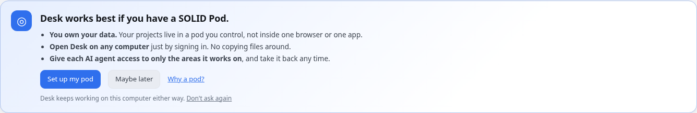
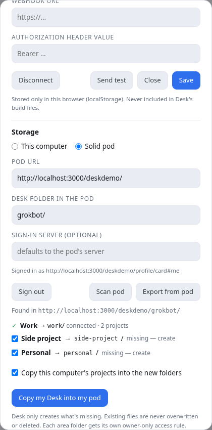
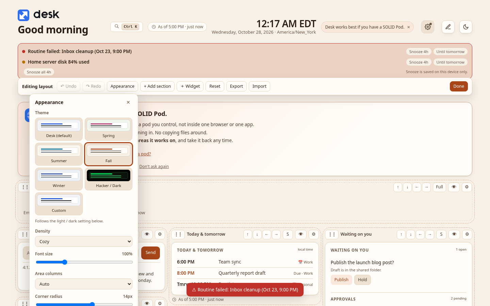
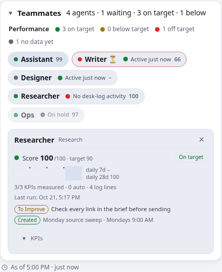
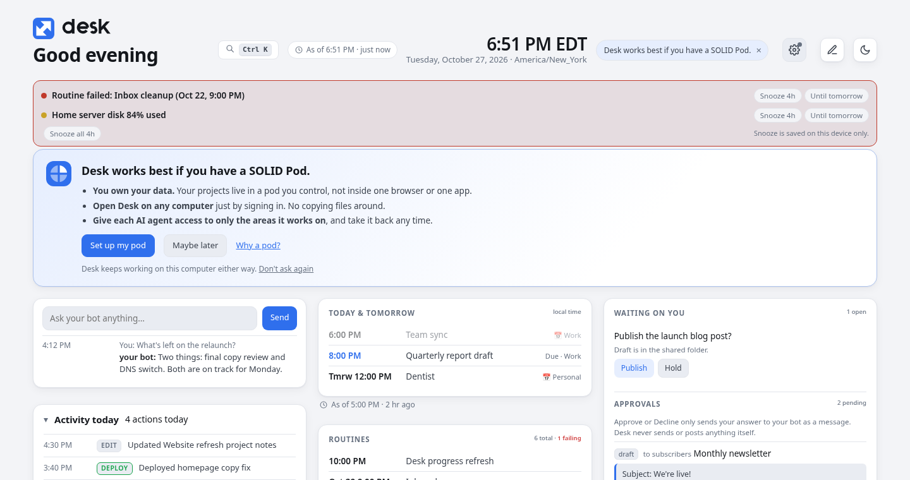
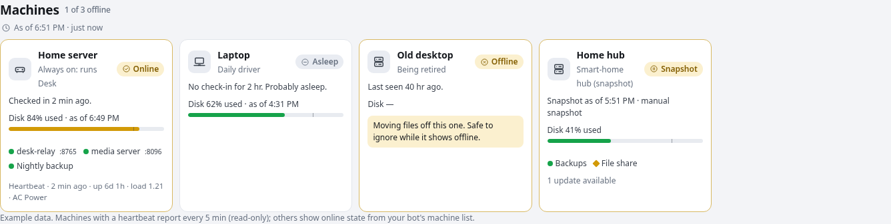
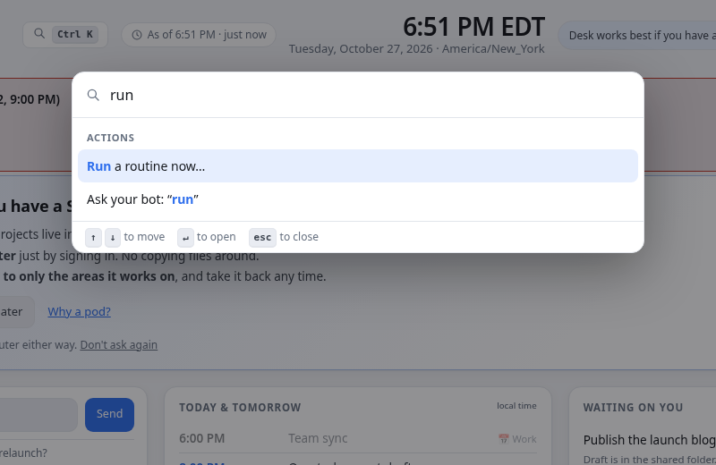

<p align="center"></p>

# Desk

Desk is a single-file, self-contained personal dashboard that you open locally in your browser (`file://`). It shows quick-launch tiles, your projects grouped by area with status, progress, priority and details, and a **Message bot** box that sends a note straight to your Grok Bot through a webhook routine.

> **Desk is deliberately _not_ a kanban or Trello board.** It is organized **by project first, then by progress**, and that is the key difference. Each project is one card with its own status, percent complete and next step. Tasks don't move between "To do / Doing / Done" columns. You see every project at a glance, grouped by area, and each one shows how far along it is and what happens next.

> **Desk works best if you have a SOLID Pod.**
>
> **Recommended: use a [Solid pod](docs/solid-pod.md).**
> - **You own your data.** Your projects live in a pod you control, not inside one browser or one app.
> - **Open Desk on any computer** just by signing in. No copying files around.
> - **Give each AI agent access to only the areas it works on**, and take it back any time.
>
> **No pod? No problem.** Local mode is the zero-setup option: install below and Desk keeps everything on this computer. You can connect a pod later from **⚙︎ Settings → Storage** ([Why a pod?](docs/solid-pod.md#why-use-a-pod) · [Get one free](https://solidproject.org/users/get-a-pod)).

## Screenshots

<p></p>
<p> </p>

_All data shown is fake example data._

## One-line install

```bash
curl -fsSL https://raw.githubusercontent.com/TeebooTed/desk/main/install.sh | bash
```

Works on macOS and Linux (needs `python3` and `curl`). It sets up `~/Desk`, the local relay and its autostart. Prefer to look first? Clone the repo and run `./install.sh`.

## Set up Desk with your bot

Paste this to your Grok Bot:

> Set up Desk for me. Follow docs/bot-template.md in github.com/TeebooTed/desk: install it on my computer, create a twice-daily "Desk refresh" routine that writes ~/Desk/status.json and ~/Desk/live.json and rebuilds, and create a "Desk messages" webhook routine that handles [Desk setup], [Desk ask], [Desk routine], [Desk approval] and [Desk · Waiting on you] messages. Then give me the webhook URL and key to paste into Desk's settings. Never put the key in any file other than the relay config.

## Works with or without a Solid pod

By default Desk keeps everything on **this computer**, exactly as described above. On a fresh install Desk shows a short welcome card once, offering to set up a pod (**Set up my pod** / **Maybe later** / **Don't ask again**), plus a small dismissible note in the header. At most one gentle reminder follows after a week of use, and **Don't ask again** turns all of it off for good. You can also switch **⚙︎ Settings → Storage** to **Solid pod** instead. Desk then reads your projects from a [Solid](https://solidproject.org/) pod you control, self-hosted or from any provider, under `<pod>/grokbot/<area>/`. Each area folder holds its own `status.json` and `updates/`.

- **No pod address to type.** Pick your provider (solidcommunity.net, Inrupt Pod Spaces, solidweb.org, or your own server), sign in, and Desk finds your pod from your profile. Folder and server details live under **Advanced**.
- **One question to finish.** Existing area folders connect silently; if some are missing Desk asks once, *"Set up N areas in your pod and copy your current Desk there?"* (or **Choose areas**). It never overwrites or deletes anything, and every area folder gets an owner-only access rule.
- **Connect another computer** with a short link or QR code that fills in your pod (no passwords or keys in it), so the other computer just signs in.
- **Agents can log straight to the pod.** **Add an agent** creates its own sign-in (automatically on Community Solid Server, step-by-step elsewhere), grants it only the areas you pick, and hands you a one-time key file for `desk-log --pod agent.env`. The secret is never shown on screen and Desk keeps no copy.
- **It always falls back to your local data.** If sign-in fails or the pod can't be reached, Desk shows this computer's data with a notice, never a blank page. **Export from pod** gives you `status.json` + `updates.jsonl` back.

Pod mode needs Desk opened over http: the relay serves it at `http://127.0.0.1:8765/app/`. See [docs/solid-pod.md](docs/solid-pod.md).

<p></p>

<p></p>

## Customize the layout

Click the pencil (or press **E**) to drag sections around, resize them, hide them, change the accent, density, font size and corners, and set per-section options. Changes save to `~/Desk/layout.json` through the local relay (and in the browser if the relay is off). Undo/redo, reset, export and import are in the edit bar. Bots can edit the same file; see [docs/layout.md](docs/layout.md). To share layout, pins and widget data between computers, see [docs/sync.md](docs/sync.md).

## Widgets

Widgets are the small panels that sit beside your project cards. Each one does one job, takes a minute to set up, and stays out of the way. Desk works best if you have a SOLID Pod, so the widgets that show your photos and posts read them straight from your pod, and nothing gets copied anywhere else.

| Widget | What it does |
|---|---|
|  **Famous Quotes**: *Real quotes, real sources, one a day.* | Ask for quotes in plain words: a topic, a person like Marcus Aurelius or Thomas Sowell, Bible verses, or a whole field. Your agent brings back 8 to 10 quotes, each checked against a real source and shown with its citation. Tick the ones you like, and Desk shows a new one each day. |
|  **Picture Frame**: *Your own photos, quietly on rotation.* | Picture Frame turns a corner of Desk into a digital photo frame. It cycles through the photos folder in your pod, one at a time. It only looks and never changes, moves or deletes a thing. |
|  **Podsta**: *Recent posts from people you follow.* | See what friends are sharing on [Podsta](https://teebooted.github.io/Podsta/), the photo app where everyone's posts live in their own pod. The widget cycles through recent posts from people you follow and only shows what each person has chosen to share with you. Tap Open in Podsta to like, comment or see more. |

Picture Frame and Podsta are built in and need a pod; without one they explain what a pod is and offer **Set up my pod** (or stay hidden if you chose *Don't ask again*). Move, resize or hide them like any other section. Famous Quotes is not in this repo yet. Details, settings and limits: [docs/widgets.md](docs/widgets.md#built-in-pod-widgets).

You can also add your own cards (links, counters, lists, metrics) via `live.json` `widgets` or a `tiles/` folder. See [docs/widgets.md](docs/widgets.md).

## Files

| Path | Purpose |
|---|---|
| `template.html` | Desk page template (favicon inlined in `<head>`) |
| `build.py` | Fills the template with a status JSON and writes `index.html` |
| `example-status.json` | Fake sample data showing the expected format |
| `relay/desk-relay.py` | Local relay (Python stdlib only) on `127.0.0.1:8765` |
| `install.sh`, `uninstall.sh` | One-step setup and removal |
| `docs/` | Screenshots, [data format](docs/data-format.md), [routine prompts](docs/routines.md) |
| `deploy/` | Example macOS LaunchAgent and Linux systemd user unit |
| `assets/` | Logo, icons, `favicon.svg/.ico`, `apple-touch-icon.png`, `build_logo.py` |
| `custom/` | Feature code inlined at build time: `features.*` (org filter, "as of" stamps, machines, ⌘K palette) and `alerts.*` (alerts, refresh history, teammate badges) |
| `icons/` | SVG icons for the new panels (inlined at build time) |
| `tools/desk_scan.py` | Safety scan run by every build; see [docs/safety-scan.md](docs/safety-scan.md) |
| `tools/machines_health.py`, `examples/machines/` | Builds the Machines panel data; example config and output |
| `heartbeat/` | Optional read-only heartbeat example for macOS; see [docs/heartbeat.md](docs/heartbeat.md) |
| `custom/theme.*` | Themes: Desk, Spring, Summer, Fall, Winter, Hacker / Dark, or Custom; see [docs/themes.md](docs/themes.md) |
| `custom/teamperf.*`, `tools/team_perf.py`, `team-perf/`, `examples/team-perf/` | Team performance: KPIs per agent, run logs, weekly review; see [docs/team-performance.md](docs/team-performance.md) |
| `tools/test_features.py`, `tools/test_themes.py`, `tools/test_teamperf.py`, `tools/test_scan.sh` | Browser tests on example data; scan test |
| `CHANGELOG.md`, `NOTICE` | What changed; credits for ideas and bundled code |
| `assets/widgets/` | Widget icons and empty-state art (light and dark) for Picture Frame, Podsta, Famous Quotes and the pod welcome card. `install.sh` copies the whole `assets/` folder |
| `assets/qrcode.js` | Small local QR generator (`qrcode-generator`, MIT) for **Connect another computer**; built by `tools/solid/` |
| `assets/solid-auth.js`, `tools/solid/` | Optional Solid pod sign-in (bundled Inrupt library, loaded only in pod mode) and how to rebuild it. See [docs/solid-pod.md](docs/solid-pod.md) |

## Quick install (Mac and Linux)

```sh
git clone <this repo> desk && cd desk
./install.sh            # installs to ~/Desk (or ./install.sh /path/to/folder)
./uninstall.sh          # removes the relay service (add --purge to delete files and saved settings)
```

`install.sh` checks for python3, copies Desk, installs and starts the relay service with real paths, builds `index.html` (from `status.json` if present, else the example), opens Desk and prints next steps. It never touches the webhook key. The manual steps below do the same by hand.

## Build

```sh
python3 build.py                 # uses example-status.json
python3 build.py my-status.json  # your own data
open index.html                  # or xdg-open on Linux
```

The status file format is documented in [docs/data-format.md](docs/data-format.md). Edit the `TILES` array in `template.html` to change the launch tiles, and set `area_order` / `area_labels` in status.json to add, rename or reorder project areas (any number of columns).

## Security design

- The webhook URL and key are kept **only** by the local relay, in `~/.config/desk-relay/config.json` (directory `0700`, file `0600`). The browser never sees or stores the key; after saving, the key field is cleared.
- The relay listens on `127.0.0.1` only, never logs requests, and caps request bodies at 100 KB.
- For optional Solid pod mode, the relay also serves Desk itself read-only at `/app/`. It serves only `index.html`, `assets/*.js|svg|png|ico` and `assets/widgets/*.svg|png`, checks the `Host` header (against DNS rebinding), and only lets the page's own origin call it.
- It accepts only requests with **`Origin: null`** (what a `file://` page sends) or no Origin at all. Any website trying to reach it gets HTTP 403.
- Endpoints: `GET /health`, `POST /config` (`{url, auth}`, https only), `POST /send` (`{message, ...}` forwarded to the webhook).
- Never commit `config.json` or your real status file (both are in `.gitignore`).

## Setup on macOS

```sh
git clone <this repo> ~/desk
cp ~/desk/deploy/com.example.desk-relay.plist ~/Library/LaunchAgents/
# edit the path YOUR_USER inside the plist, then:
launchctl load ~/Library/LaunchAgents/com.example.desk-relay.plist
curl -s http://127.0.0.1:8765/health
```

## Setup on Linux

```sh
git clone <this repo> ~/desk
mkdir -p ~/.config/systemd/user
cp ~/desk/deploy/desk-relay.service ~/.config/systemd/user/
systemctl --user daemon-reload
systemctl --user enable --now desk-relay
curl -s http://127.0.0.1:8765/health
```

## Creating a Grok Bot webhook routine

1. In Grok Bot, ask your bot to create a **routine with a webhook trigger** (for example: "Create a webhook routine that treats incoming Desk messages as notes from me").
2. Copy the webhook **URL** and its **authorization key** that the routine shows you.
3. Open `index.html`, click the gear icon (**Connect to your bot**), paste the URL and key, and click **Save**. Desk hands them to the relay and forgets the key.
4. Click **Send test**. The reply arrives in your Grok Bot chat.

Ready-to-paste routine prompts (webhook receiver and twice-daily refresh) are in [docs/routines.md](docs/routines.md).

## Logo

The logo and favicons in `assets/` (light, dark and tile variants) are regenerated with `assets/build_logo.py`.

## License

MIT. See `LICENSE`.

## New: themes and team performance

<p></p>
<p></p>

- **Themes**: in Customize layout → Appearance, pick **Desk** (the default look), **Spring**, **Summer**, **Fall**, **Winter**, **Hacker / Dark**, or **Custom** (your own background, card, card border, accent and text colours, with a live preview and a contrast report). Seasonal themes have light and dark versions and follow the Light / dark setting. Every preset passes WCAG AA contrast. See [docs/themes.md](docs/themes.md).
- **Team performance**: give each agent a goal and 3-5 KPIs with targets; agents log every run with `team-perf/log-run`; `tools/team_perf.py` scores them (0-100 vs target, green / amber / red, grey when there's too little data) and the Teammates panel shows a score, a 28-day sparkline, the last run, open improvements and each agent's recurring jobs. Comes with a general self-improvement rule (`team-perf/RULE_GENERAL.md`) that never widens permissions, and a weekly review cadence. The demo uses a small example team in `examples/team-perf/`. See [docs/team-performance.md](docs/team-performance.md).

## New: org filter, machines, ⌘K palette, alerts, approvals

<p></p>
<p> </p>

- **Org (area) filter**: chips for each area above Projects (Shift-click to combine). Also filters Today, Waiting, approvals and counts by each item's `area`.
- **"As of" stamps** on every section, so old data is obvious; missing numbers show "—", not 0.
- **Machines panel**: online/asleep/offline, last seen, disk, services. Data from `tools/machines_health.py`; optional read-only [heartbeat](docs/heartbeat.md) for live disk and service numbers.
- **Command palette**: ⌘K / Ctrl+K to search projects, agents, machines and actions.
- **Alerts banner** with snooze, **refresh history** in Routines, **teammate badges**.
- **Approval cards**: Approve / Edit / Decline send `[Desk approval] <id> <answer>` to your bot. Desk itself never posts.
- **Safety scan**: every build is scanned for secrets, emails, dollar amounts, IPs and cross-area leaks; if anything blocks, nothing is written. See [docs/safety-scan.md](docs/safety-scan.md).

Details: [docs/features.md](docs/features.md). History: [CHANGELOG.md](CHANGELOG.md).

## New: agents log their own progress

Agents that share the Desk folder can update their cards in real time:
`./desk-log --agent Scout --project website-refresh --note "Homepage draft approved" --percent 80`.
Entries go to an append-only `updates.jsonl` (file-locked, git-ignored). `build.py` merges the newest entry into each card
(last update, who, and optionally percent/status/next step, never priority) and adds the notes to its Recent list.
`./desk-watch --ensure` rebuilds within about 2 minutes of a change. See [docs/agent-logging.md](docs/agent-logging.md).

## New: ask from any card, "last updated" stamps

- **Ask your bot on every card**: each project card (and its pop-up) has an *Ask* button that opens a small box (with dictation where the browser supports it) and sends `[Desk card] <Area> · <Project> (id <project id>) — <message>` through the same local helper, with `area`, `project` and `project_id` fields. The card shows a sent/failed confirmation.
- **Last updated**: each card shows "Updated 3h ago by …" from `last_update` + optional `updated_by` (exact time on hover). Cards that are not done and haven't been updated in 48 hours get a subtle amber **Stale** marker, and each column header shows "N stale". See [docs/data-format.md](docs/data-format.md).

## New: first-run setup, Ask box, routine panel

- **First-run setup**: with no data, Desk shows a Welcome card that asks your bot to fill everything in (or copy the request into chat). See `docs/data-format.md` → *Sample prompt*.
- **Ask your bot**: a one-line box that sends `[Desk ask] …` through the local helper; short replies appear under it after the bot updates `live.json` → `replies`.
- **Routines**: a collapsible panel listing your bot's routines (schedule, next/last run, status) with Pause / Resume / Run now. Failures are highlighted.

All page-to-bot messages go through the local helper on 127.0.0.1:8765; no webhook secret is ever in the page or data files.
- **Teammates**: one compact card per agent (what it is doing, what it waits on).
- **Activity today**: what your bot actually did (sends, deploys, edits, posts), newest first.
- **Approvals**: drafts and posts in "Waiting on you" with Approve / Edit / Reject.
