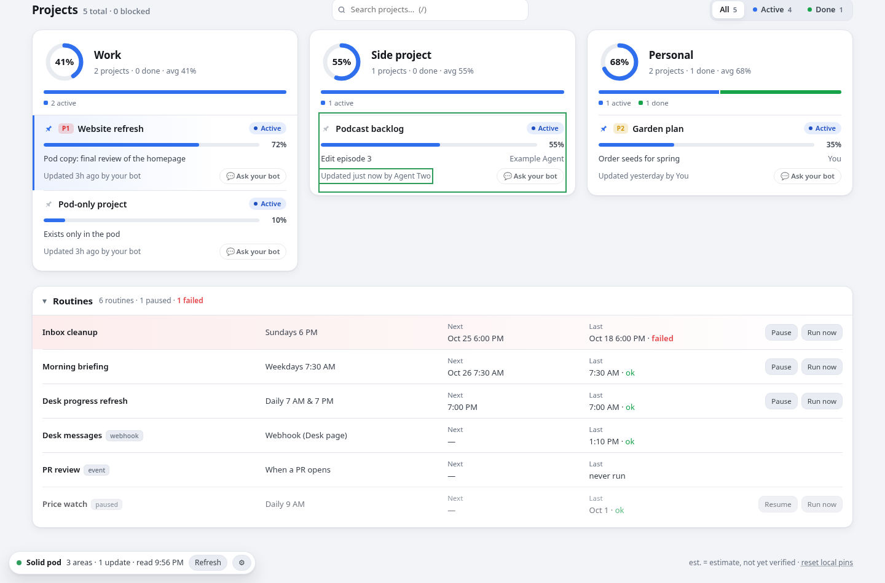

# Desk with a Solid pod (recommended)

**Desk works best if you have a SOLID Pod.** It still works fully **without** one: a [Solid](https://solidproject.org/) pod is recommended, never required.

- **This computer (default).** Same as always: `build.py` bakes your status JSON into `index.html`, agents run `desk-log` to add to `updates.jsonl`, and nothing leaves your machine. If you never open the Storage setting, nothing changes. No pod code is loaded; the only thing Desk remembers is whether you've seen the pod welcome card (`desk-pod-nudge` in localStorage).
- **Solid pod.** Desk reads your projects and updates from a pod you control. Agents write their progress there with their own credentials, and you can give each one access to only the areas it works on.

## Why use a pod?

- **One copy, many devices.** Your laptop, phone, and agents running elsewhere all read and write the same data. You don't need to sync files.
- **You own it.** The pod can be self-hosted, such as the Community Solid Server on your own box, or run by any provider. Desk talks standard Solid (LDP + WAC), so you can switch providers without changing Desk.
- **Fine-grained agent access.** Each area folder has its own access rule. An agent that only works on "Side project" can be granted that folder and nothing else.

### How Desk suggests a pod (and how to turn it off)

- **Welcome card, once.** On a fresh install Desk shows one card above your projects: "Desk works best if you have a SOLID Pod." with the three points above. **Set up my pod** opens a short flow ("I have a pod" → paste its URL and sign in, or "I don't have a pod yet" → free providers and how to host your own). **Maybe later** hides it.
- **A small header note** with the same sentence. Click it for a plain-words "Why a pod?" explainer; the × hides it. The same explainer is linked from **⚙︎ Settings → Storage**.
- **At most one reminder**, after at least 7 days and 3 separate days of use. It never repeats.
- **Don't ask again** (on the card) turns off the card, the note and the reminder for good on that browser.
- **Nothing shows in pod mode.** No countdowns, no blocking: every part of Desk works the same either way.

## Folder layout

Desk keeps everything under a single folder in your pod, `grokbot/` by default. You can change it in settings. Each area gets its own subfolder:

```
<pod>/grokbot/
  meta.json                 # area order, labels, area->folder map, time zone (schema "desk-pod/1")
  .acl                      # owner-only
  work/
    status.json             # {"area": "Work", "label": "Work", "projects": [ ... same project objects as status.json ... ]}
    updates/                # one JSON file per update (same fields as a line of updates.jsonl)
    .acl                    # owner-only by default; add agents per area
  side-project/
    status.json
    updates/
    .acl
  personal/
    ...
```

Both modes use the same data format. Projects are the objects from [data-format.md](data-format.md), and each update file holds exactly one `updates.jsonl` entry. Desk merges them with the same rules as `build.py`: notes, `percent`, `next_step`, status, the 12-note cap, and so on.

### Area to folder mapping (data-driven)

The folder for an area is chosen in this order:

1. `area_folders` in the pod's `meta.json`;
2. `area_folders` in your local status JSON, for example:
   ```json
   "area_folders": { "Side": "side-project" }
   ```
3. otherwise a slug of the area key (`Work` → `work/`, `Personal` → `personal/`).

When Desk reads the pod, each folder's `status.json` records which area it holds (`"area"`), so you can also rename folders without breaking anything. Just keep `area` the same.

## Setup

### 1. Get a pod

**Self-hosted, Community Solid Server (CSS):**

```bash
npx @solid/community-server@7 -p 3000 -c @css:config/file.json -f ~/solid-data
```

Open `http://localhost:3000/`, create an account, and create a pod (for example `you`). Your pod URL will be `http://localhost:3000/you/`.

**Any provider.** Any Solid server that supports WAC or ACP works. Use the pod URL it gives you. If its sign-in (OIDC issuer) is on a different host than the pod, enter that host under **Advanced → Sign-in server**.

### 2. Open Desk over http

Solid sign-in redirects back to the page, so Desk must be opened over http(s), not `file://`. The local relay serves Desk at:

```
http://127.0.0.1:8765/app/
```

The relay only serves `index.html` and `assets/`, and it checks the `Host` and `Origin` headers. If you open `index.html` as a file while in pod mode, Desk shows your local data with a notice telling you to use the address above.

### 3. Choose your pod (no address to type)

Click **Set up my pod** (welcome card, header note, or ⚙︎ Settings → Storage → **Choose my pod**), then **I have a pod**. Pick your provider:

- **solidcommunity.net**, **Inrupt Pod Spaces**, **solidweb.org**: one click, then sign in there.
- **My own server**: one field, the server's address (e.g. `http://localhost:3000/`). If you paste a full pod address (with a path), Desk uses it as the pod.

After you sign in, Desk finds your pod by itself: it reads your profile's storage (`pim:storage` / `solid:storage`), then looks for the pod root, and falls back to your server's root. If your profile lists more than one pod, Desk uses the first; you can change it under **Advanced**.

**Advanced** (in the flow and in ⚙︎ Settings → Storage) holds the things most people never need: the pod address, which pod to use when there are several, the **Desk folder in the pod** (default `grokbot/`), the sign-in server, and the folder each area maps to.

These settings are kept in this browser's localStorage (`desk-storage`). They never go into build files.

### 4. One question: set up your areas

Right after sign-in Desk checks your pod:

- Area folders that already exist connect silently. Desk uses them as they are.
- If any are missing, you get **one** question: *"Set up N areas in your pod and copy your current Desk there?"* **Yes** is the default. **Choose areas** opens the checkbox list (**✓ connected** / **missing — create**) if you only want some of them.


You can run the same check later with ⚙︎ Settings → **Check my pod**.

Desk **only creates what's missing**:

- Every write uses `If-None-Match: *`, so an existing file is never overwritten.
- Nothing is ever deleted.
- Each new folder gets an **owner-only** `.acl` (only your WebID can read, write, or control it).
- On ACP servers, which use `.acr`, folders inherit the pod's private default instead.

### 5. Connect another computer

Once connected, choose **Connect another computer** (at the end of setup or in ⚙︎ Settings). Desk shows a short link and a QR code. Open it on the other computer: the provider, pod and folder are filled in, so that computer only has to sign in.

The link carries only public addresses (`#pod=…`, plus the sign-in server and folder if they're not the defaults). It never contains passwords, tokens or keys, and Desk removes it from the address bar after reading it. The QR code is drawn locally by `assets/qrcode.js`; nothing is sent to a QR service.

**New areas later.** Once `meta.json` exists, any area you add on this computer automatically gets its own folder, created the next time Desk reads the pod.



The pill in the bottom-left shows the state:

- **green**: reading the pod (with the time of the last read and **Refresh**);
- **amber**: not signed in or nothing set up yet;
- **red**: fallback.

Desk re-reads the pod every 60 seconds and when the tab becomes visible again. Changed cards are briefly outlined.

### Fallback: never a blank page

If sign-in fails, the pod server is unreachable, a request times out, or the pod URL is wrong, Desk shows **this computer's data** with a clear notice and a **Retry** button. Switching Storage back to **This computer** returns to exactly the normal local behavior.

## Agents: client credentials and per-area access

Agents don't sign in through a browser. They use **client credentials** (an ID and secret tied to the agent's own WebID).

### Add an agent (the easy way)

⚙︎ Settings → **Add an agent** (or at the end of setup):

1. Name the agent and tick the areas it may update.
2. **On Community Solid Server** Desk does the rest: it creates a separate account and identity just for the agent on your pod server (your own account and password are never asked for or changed), creates its client credentials, and gives it **Read + Append** on only the folders you ticked.
3. **Download its key file once** (`<name>.env`). Desk never shows the secret on screen and doesn't keep a copy; closing the dialog without downloading discards it. Put it on the computer where the agent runs, e.g. `~/.config/desk/`, `chmod 600` it, and keep it out of any git repo. The file also holds the agent account's generated login, so you can sign in there later to delete its credentials.

**Other providers** (no account API Desk can use): Desk shows plain steps instead: make a separate account for the agent, create client credentials there (Inrupt: register an app at `login.inrupt.com/registration.html`), and paste the agent's WebID. Desk then grants the areas you ticked and gives you a key file to fill in the ID and secret.

To take access away, remove the agent's rule from the area folder's `.acl` (see below) or delete its credentials.

### Doing it by hand

**On CSS:** sign in at `<server>/.account/`, open **Client credentials**, pick the WebID the agent should act as, and create a token. Give the agent its own WebID (a separate account) so you can grant it only certain areas. Other providers have a similar page.

Put the credentials in an env file that never goes in any repo, and `chmod 600` it:

```bash
# ~/.config/desk/agent-two.env
DESK_POD_URL=https://pod.example.org/you/
DESK_POD_ROOT=grokbot/            # default
DESK_POD_ISSUER=https://pod.example.org/   # default: the pod's server
DESK_POD_CLIENT_ID=...
DESK_POD_CLIENT_SECRET=...
DESK_POD_AREAS=side-project       # optional: the folders this agent may use
```

Then:

```bash
desk-log --pod ~/.config/desk/agent-two.env --list
desk-log --pod ~/.config/desk/agent-two.env --project podcast-backlog --percent 55 --note "Recorded two episodes" --agent "Agent Two"
# or: export DESK_POD_ENV=~/.config/desk/agent-two.env
```

`desk-log --pod`:

- reads the projects from the area folders it can see;
- finds the project's area;
- writes the update as a new file in **that area's** `updates/` folder.

It uses DPoP-bound tokens when the Python `cryptography` package is installed, and plain Bearer tokens otherwise. Without `--pod`, `desk-log` works exactly as before.

### Granting an agent one area

Every area folder's `.acl` is owner-only by default. To let an agent write to just `side-project/`, add a rule to `grokbot/side-project/.acl`. You can do this with any Solid file browser (such as Penny or mashlib), or with a PUT:

```turtle
@prefix acl: <http://www.w3.org/ns/auth/acl#>.

<#owner> a acl:Authorization; acl:agent <https://pod.example.org/you/profile/card#me>;
  acl:accessTo <./>; acl:default <./>;
  acl:mode acl:Read, acl:Write, acl:Control.

<#agent-two> a acl:Authorization; acl:agent <https://pod.example.org/agent-two/profile/card#me>;
  acl:accessTo <./>; acl:default <./>;
  acl:mode acl:Read, acl:Append.
```

- `acl:Append` is enough for `desk-log` to add updates.
- Give `acl:Write` too if the agent should also edit `status.json`.
- Because the agent can't list the root folder, set `DESK_POD_AREAS=side-project` in its env file.

An agent without a grant on an area gets "403" from the pod and simply doesn't see that area's projects.

## Moving data between modes

- **Into the pod:** answer **Yes** to the set-up question, or use ⚙︎ Settings → **Check my pod** → **Copy my Desk into my pod** (above).
- **Out of the pod:** click **Export from pod** in settings. Desk downloads `status.json` and `updates.jsonl` in the normal local format. Put them next to `build.py` and run:
  ```bash
  python3 build.py status.json
  ```
  The result is the same cards you saw in pod mode, and plain `desk-log` keeps working on the exported files.

## For developers

- The Solid sign-in library (Inrupt's `@inrupt/solid-client-authn-browser`, MIT) is pre-bundled as `assets/solid-auth.js`. It is loaded only in pod mode. To rebuild it:
  ```bash
  cd tools/solid && npm install && node build.mjs
  ```
  The same build writes `assets/qrcode.js` (Kazuhiko Arase's `qrcode-generator`, MIT), the small local QR generator used by **Connect another computer**. It is loaded only when that dialog opens.
- Storage lives in one small layer in `template.html`, `window.DeskStore`, with two backends that share the same interface: load status and areas, load updates, append an update, and save status. The `local` backend is the data baked in by `build.py`. The `pod` backend implements the same interface on top of the pod's area folders.
